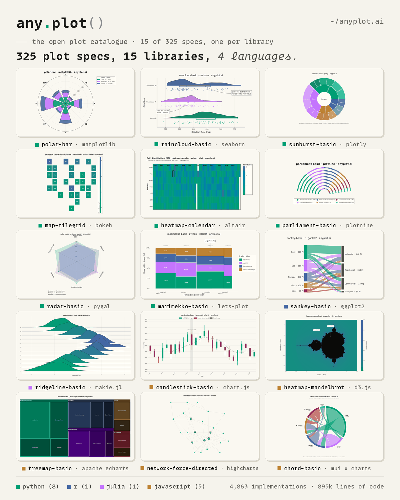
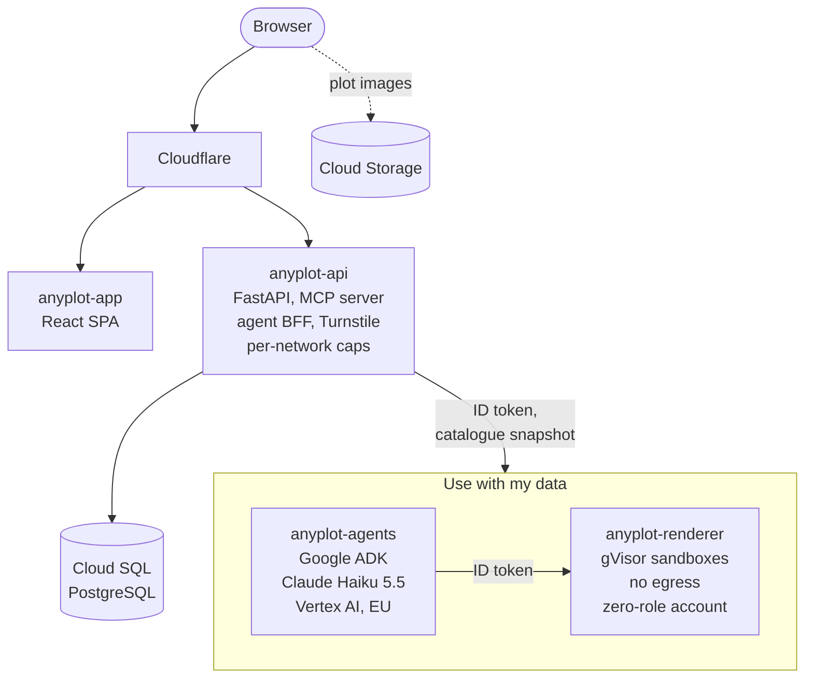
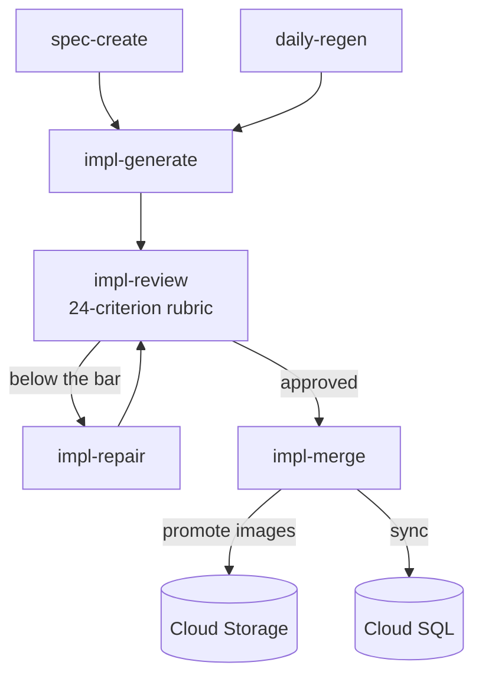

**→ [anyplot.ai](https://anyplot.ai)**

[](https://github.com/MarkusNeusinger/anyplot/releases)
[](https://www.python.org/)
[](LICENSE)
[](https://github.com/MarkusNeusinger/anyplot/actions/workflows/ci-tests.yml)
[](https://github.com/MarkusNeusinger/anyplot/actions/workflows/ci-lint.yml)
[](https://codecov.io/github/MarkusNeusinger/anyplot)

anyplot is an open catalogue of plotting examples. Each plot type starts as one library-agnostic specification, and an
AI pipeline writes, renders, reviews, and maintains its implementations in 15 plotting libraries across Python, R,
Julia, and JavaScript. On [anyplot.ai](https://anyplot.ai), you compare the libraries side by side and copy working
code.

## How I build anyplot

I'm [Markus Neusinger](https://linkedin.com/in/markus-neusinger/), a physicist and data analyst: since 2013 I've built data pipelines, analyses and machine learning, and the apps people use them through. On anyplot, models write the code. I decide what gets built and what counts as good, and I check what comes back; the design documents and pull requests record many of those decisions with their dates.

- **I set the course.** The vision, the decisions, and the structure that keeps a codebase written by agents from turning into a mess. Six of those decisions are [below](#engineering-highlights).
- **I know when to push back.** The models know a lot. The job is knowing which question to ask, when to make a model research a point properly, and when a confident answer is wrong.
  - *Real data.* A model compared plot quality on invented datasets that fitted the plots too
    neatly, so I had it fetch real weather downloads. A raw file with two metadata lines above the
    table broke the import at once. Since then pasted data has to work with notes, metadata or total
    rows around the table ([#12166](https://github.com/MarkusNeusinger/anyplot/pull/12166)).
  - *No real parties.* For a parliament chart, one library's implementation used the real European
    Parliament groups and the AI reviewer scored that 5 of 5 as "authentic political data"; three
    others dodged the topic with a faculty senate, a board or sports conferences. I ruled for
    invented parties and seats, and the rubric no longer marks a fictional chamber down
    ([#12050](https://github.com/MarkusNeusinger/anyplot/pull/12050)).
  - *Exact data.* An audit of the chat's data path found values rounded or dropped without a word,
    such as digits past a float's precision. My rule: what you paste is what the data holds, or a
    line says what changed and how often ([#12196](https://github.com/MarkusNeusinger/anyplot/pull/12196)).
- **I split, assign, test, and send back.** Work goes to Claude Code, Claude in GitHub Actions, Gemini or Copilot by what it needs and what it costs. I test what comes back and return it until it's right.

This isn't one prompt and a wait. Since November 2025, more than 1,000 pull requests from my account have merged and 17 releases have shipped. A new spec needs my approval, and outside the plot pipeline the agents merge nothing without my OK. What I correct becomes a rule the agents follow. [How anyplot is built with AI agents](docs/concepts/ai-workflow.md) tells the whole story.

[](https://anyplot.ai/plots)

*One spec in each library, drawn from the live catalogue by
[`scripts/readme_showcase.py`](scripts/readme_showcase.py). [Browse all plots](https://anyplot.ai/plots).*

---

## Engineering highlights

Six decisions I made and hold the agents to, each with its reason and the code that carries it out:

- **A review loop instead of hand-edits.** A wrong plot is fixed in its spec or in a rule and then regenerated,
  not patched by hand. A fix to a prompt or a spec reaches every plot it governs at that plot's next regeneration.
  An AI reviewer scores every render on a 24-criterion rubric, and a repair loop fixes the defects it names,
  against a bar that starts at 90 of 100 and drops 10 points per repair. Pipeline reviews run on Opus because it
  is the stricter and the steadier reviewer: on the same plots it scored about 8 points below Sonnet, and across
  repeated runs the gap it measured between a new version and the old one spread 1.3 points, against 4.6.
  ([rubric](prompts/quality-criteria.md), [#11968](https://github.com/MarkusNeusinger/anyplot/pull/11968))
- **A gate against silent regressions.** In an experiment on one spec, 39 of 75 regenerations failed their first
  review and merged after repairs at the lowered bar, some replacing a better version (93 → 88). Now one review
  scores the new version and scores the live one again under today's rules, because a stored score from an older
  rubric or another reviewer can't be compared with a new one. The new version replaces the live one only with no
  regression, a score at most a point lower, and a fix the review can verify; a code conversion for the chat
  passes on an unchanged render instead. My rule: a regeneration never makes an implementation worse.
  ([`regen_gate.py`](automation/scripts/regen_gate.py), [#11945](https://github.com/MarkusNeusinger/anyplot/pull/11945))
- **A score belongs to the code that drew it.** An audit of the live catalogue in November 2026 traced 50 findings
  to renders that didn't come from the merged code. Generation and repair now stage a hash of the code they
  rendered, and a review whose hash is missing or doesn't match the code at the pull request's head stops before
  it scores; a regeneration then keeps the live version. It only warned at first: from 2026-11-10 to 2026-11-16,
  all 39 production reviews matched. ([`render_hash.py`](automation/scripts/render_hash.py),
  [#13034](https://github.com/MarkusNeusinger/anyplot/pull/13034),
  [#13129](https://github.com/MarkusNeusinger/anyplot/pull/13129))
- **Private by construction.** Chats and data live only in server memory, unless you send feedback, and are dropped
  after an hour idle; the public chat's session id travels in a header, not in a URL. My rule for usage telemetry:
  enums, buckets, and counts only, keyed by hashes under a per-process salt, never a message, a data value, or a
  column name; a canary test fails if a message or a data value reaches the agent service's logs.
  ([telemetry](agents/anyplot/telemetry.py), [canary test](tests/unit/agents/runtime/test_canary.py))
- **A check counts before it blocks.** A check compares the figures a chat reply writes in digits with what the
  model was given. It ships counting only, because no eval with a real model reached the path where it would
  withhold a reply; I decide from the counts of real use when it starts blocking. Every release runs the chat's
  evals first, since a regression once surfaced only because another pull request happened to run them.
  ([#13145](https://github.com/MarkusNeusinger/anyplot/pull/13145), [evals](agents/evals/))
- **An incident becomes a check.** After a green pull request and a green deploy left anyplot.ai blank for 45
  minutes, I made a browser check of the live site a step after every merge; CI runs it on the built image too when
  the image's inputs change. This README is held the same way: a test reads its numbers from the code and fails
  when a bound moves and the text doesn't. ([site smoke test](scripts/site-smoke.mjs),
  [claim tests](tests/unit/test_readme_claims.py), [guardrails](.claude/guardrails.md))

## Architecture

The site and "Use with my data":



The catalogue pipeline, in GitHub Actions, writing to the same storage:



All of it runs live at [anyplot.ai](https://anyplot.ai).

## The catalogue in numbers

| Specifications | Implementations | Libraries | Languages |
|---------------:|----------------:|----------:|----------:|
| 325 | 4,863 | 15 | 4 |

Counted on 2026-11-02 from the public API (`https://api.anyplot.ai/stats`); the [stats page](https://anyplot.ai/stats)
shows the current numbers. 316 of the 325 specs exist in all 15 libraries; the other nine, mostly 3D and map plots,
lack one or two.

| Language | Libraries |
|----------|-----------|
| Python | matplotlib, seaborn, plotly, bokeh, altair, plotnine, pygal, lets-plot |
| R | ggplot2 |
| Julia | Makie.jl |
| JavaScript | Chart.js, D3.js, ECharts, Highcharts, MUI X Charts (React) |

## What you can do on the site

- **Compare libraries.** Each spec page shows the same plot in every library, usually all 15, in a light and a dark
  theme, each with its code and its review score.
- **Search and filter.** A typo-tolerant search matches spec titles and tag values, and the matches become filters:
  language, library, plot type, data structure, domain, and features, plus implementation tags such as techniques,
  dependencies, and styling.
- **Explore by similarity.** The [map](https://anyplot.ai/map) draws the catalogue as a graph of specs linked by tag
  similarity, and every spec page lists related specs.
- **Use it from an AI assistant.** The [MCP server](#mcp-server) serves the same catalogue to coding agents.

## How the pipeline works

AI writes every implementation, most of them Claude running in GitHub Actions. GitHub issues hold the state of each
plot.

1. **Request.** Someone opens an issue, from GitHub or from a link on anyplot.ai.
2. **Specification.** `spec-create.yml` checks for duplicates, assigns a spec ID and tags, and opens a pull request with
   the spec. I approve it on the issue; since September 2026 the merge job ignores the label from any other account.
3. **Generation.** `impl-generate.yml` writes one implementation per library, runs it, and renders it in both
   themes; without both renders it stops.
4. **Review.** `impl-review.yml` first runs automated checks: both renders exist and the canvas has its target
   size. An AI reviewer then scores the render, with the stored score kept out of its working tree and its prompt,
   on a 100-point rubric of 24 criteria ([`prompts/quality-criteria.md`](prompts/quality-criteria.md)): visual quality 30,
   design 20, spec compliance 15, data quality 15, code quality 10, and library mastery 10.
5. **Repair.** Below the bar, `impl-repair.yml` fixes the defects the review named, and the plot is reviewed again.
6. **Merge.** `impl-merge.yml` merges the pull request, promotes the images from staging to production in Cloud
   Storage, and syncs PostgreSQL.

### The quality bar

- A first review needs **90 of 100**. Each repair lowers the bar by 10 points: 80, 70, 60, and 50 after the fourth and
  last repair. An implementation still below 50 is closed and marked failed.
- The rubric reserves 90 and more for a plot that "should genuinely impress a data visualization professional". The
  reviewer never sees the thresholds.
- Technical criteria start at full points and lose them only through a written defect line that names the criterion,
  the observed value, and the fix. Design and library criteria start at a default and rise only with named evidence.
- Code that fails to run, a blank image, clipped labels, or a static library faking interactivity scores 0.
- One exception to the bar: a review of 80 or more that names no defect and gives every technical criterion its full
  points is approved, because a repair would have nothing to fix.

### Nightly regeneration

`daily-regen.yml` regenerates the oldest part of the catalogue every night: by default the oldest spec in every
library, and since 2026-10-31 the oldest single implementations instead. A regeneration replaces the live
implementation only with no regression, a score at most a point lower, and a fix its review can verify; a code
conversion for the chat passes on an unchanged render instead (the regen gate).

For the labels, retries, and every workflow, see [Workflows](docs/workflows/overview.md).

## Use with my data (agent chat)

> **Status:** experimental, open to every visitor since 2 November 2026.

On a plot page, choose **use with my data** and paste your own data. An agent adapts that plot's catalogue code to your data, renders it in a
sandbox, reviews the render against the catalogue's rubric, repairs it once if needed, and returns the image and the
code.

- **One agent talks, code decides.** One Google ADK agent talks to the user. The per-library adapters and the
  reviewer run inside a pipeline whose loop is plain code: at most one repair round, at most two reviews, and the
  spec, library, and data come from server state, so neither the model nor an injected prompt can redirect a run.
  ([`pipeline.py`](agents/anyplot/pipeline.py), [design](docs/concepts/agent-network.md))
- **Models choose, the server acts.** The assistant never hands the server data rows: it picks from a closed set
  of typed operations, which the server applies with pandas and reports with counts.
  ([operations](agents/anyplot/data/prepare.py))
- **Agents.** A [Google ADK](https://adk.dev) service on Cloud Run. The model is Claude Haiku 5.5 through Vertex AI in
  the EU; Gemini 3.8 Flash is a configurable second arm. Runtimes exist for all 15 libraries.
- **Sandboxed rendering.** No model-written code runs in the agent service. A separate renderer runs it in Cloud Run
  sandboxes (gVisor): no network egress, no metadata server, and a read-only root filesystem. The renderer's service
  account holds no IAM role.
- **Static validation.** Before anything runs, a validator reads the code (Python's `ast`, tree-sitter for R, Julia,
  and JavaScript) and refuses disallowed imports and calls.
- **Guard judges.** A scope judge reads every typed message before any agent sees it and fails closed; a dataset judge
  checks pasted data and notes. Spend limits apply per user and per day, and a budget guard switches Vertex AI off when
  its monthly budget is reached.
- **Evals.** A model-regression harness runs synthetic, stress, and promoted real cases; separate evals score the scope
  judge and the data preparation.
- **Content-free telemetry.** Usage events hold only enums, buckets, counts, and IDs from closed sets. No message, data
  value, or column name reaches a line, and a test enforces it.

Read the [agent network design](docs/concepts/agent-network.md), the [agents README](agents/README.md), and the
[telemetry reference](docs/reference/agent-telemetry.md).

## MCP server

anyplot runs an [MCP (Model Context Protocol)](https://modelcontextprotocol.io/) server, so AI assistants can search
the catalogue and fetch implementation code.

| Tool | What it does |
|------|--------------|
| `list_specs` | Lists all plot specifications |
| `search_specs_by_tags` | Finds specs by tags: plot type, data type, domain, features, library, and implementation tags |
| `get_spec_detail` | Returns a full specification with its implementations |
| `get_implementation` | Returns the code for one library |
| `list_libraries` | Lists the supported libraries |
| `get_tag_values` | Lists the values of a tag category |

Add it to your MCP client configuration, for example Claude Code's `.mcp.json`:

```json
{
  "mcpServers": {
    "anyplot": {
      "command": "npx",
      "args": ["-y", "mcp-remote", "https://api.anyplot.ai/mcp/"]
    }
  }
}
```

The server speaks Streamable HTTP only. Clients with native support connect to `https://api.anyplot.ai/mcp/` without
the `mcp-remote` bridge. The legacy SSE endpoint (`https://api.anyplot.ai/sse/`) has been removed. For details, see
[MCP server](docs/reference/mcp.md).

Each MCP request is counted as one content-free line: the tool's name and any catalogue id it looked up, never its
other arguments or its results. The [stats page](https://anyplot.ai/stats) shows how many arrived in the last 28
days, beside the verified crawler reads per day; see [Machine readers](docs/reference/machine-readers.md).

## Tech stack

| Area | Stack |
|------|-------|
| Backend | Python 3.14, FastAPI, SQLAlchemy (async), PostgreSQL, Alembic |
| Frontend | React 19, TypeScript, Vite, MUI |
| Agents | Google ADK, Claude Haiku 5.5 on Vertex AI, Cloud Run sandboxes |
| Pipeline | GitHub Actions with Claude Code |
| Infrastructure | Cloud Run, Cloud SQL, Cloud Storage, Cloud Build, BigQuery, Cloudflare |

Each render runtime is pinned: Python by `pyproject.toml` and `uv.lock`, the JavaScript libraries by `package.json` and
`package-lock.json`, Julia by `Project.toml` and `Manifest.toml`, and R by a dated Posit Package Manager snapshot.

## Project structure

```
anyplot/
├── plots/              # One directory per plot type: spec, metadata, implementations
├── prompts/            # Generation and review prompts, the quality rubric
├── .github/workflows/  # The pipeline (spec-create, impl-*, daily-regen) and CI
├── api/                # FastAPI backend and the MCP server
├── app/                # React frontend
├── agents/             # "Use with my data": ADK agent service, sandbox renderer, evals
├── core/               # Shared Python logic: database, palette, checks
├── automation/         # Workflow scripts: sync, labels, the regen gate, the JS render harness
├── alembic/            # Database migrations
├── tests/              # Unit, integration, and end-to-end tests
├── infra/              # Cloudflare configuration
├── scripts/            # Maintenance scripts
├── tools/, changelog.d/  # Changelog tooling and one changelog fragment per pull request
├── agentic/            # Commands and docs for the coding agents that work on this repository
└── docs/               # Documentation
```

The root `package.json` and `package-lock.json` pin the JavaScript render runtime, and `Project.toml` and
`Manifest.toml` pin the Julia one. A plot directory looks like this:

```
plots/scatter-basic/
├── specification.md     # Library-agnostic specification
├── specification.yaml   # Tags, creation date, issue
├── metadata/            # Per-library quality score, review, preview URLs
└── implementations/
    ├── python/          # matplotlib.py, seaborn.py, … (8 files)
    ├── r/ggplot2.R
    ├── julia/makie.jl
    └── javascript/      # chartjs.js, d3.js, echarts.js, highcharts.js, muix.tsx
```

For every directory, see [Repository structure](docs/reference/repository.md).

## Contributing

You contribute ideas, not code: the pipeline writes every implementation.

| Action | When to use | On anyplot.ai |
|--------|-------------|---------------|
| Suggest a spec | Propose a new plot type | `spec.suggest()` on the home page and the specs list |
| Report a spec issue | A specification has a problem | "report issue" on the spec page |
| Report an implementation issue | One library's implementation has a problem | "report issue" on the spec page |

1. Open an issue, on GitHub or through a link on anyplot.ai.
2. The AI validates and processes it.
3. I review and approve it.
4. The pipeline generates or fixes the code, and the review gates it.

Don't open pull requests with plot code. A plot with quality problems usually needs a better spec, not hand-edited code.
For details, see [Contributing](docs/contributing.md). To run the project locally, see the
[development guide](docs/development.md).

## Documentation

- [Vision](docs/concepts/vision.md): the product vision
- [Workflows](docs/workflows/overview.md): the automation and its labels
- [Agent network](docs/concepts/agent-network.md): the design of "Use with my data"
- [How anyplot is built with AI agents](docs/concepts/ai-workflow.md): who does what, the path of a change,
  and how corrections become rules
- [Reference](docs/reference/): API, MCP, database, repository structure, and style guide
- [Documentation index](docs/index.md): everything else

## License notes

Most plotting libraries are fully open source. **Highcharts** is free for non-commercial use; commercial use requires a
license from [highcharts.com](https://www.highcharts.com/license).

The project is under the MIT License; see [LICENSE](LICENSE). The JetBrains Mono fonts bundled in
`agents/anyplot/render/fonts/` for the footer strip of user plots are third-party files under the SIL Open Font License
1.1; see [their notice](agents/anyplot/render/fonts/README.md).

## Links

- **Website**: [anyplot.ai](https://anyplot.ai)
- **Issues**: [GitHub Issues](https://github.com/MarkusNeusinger/anyplot/issues)
- **Discussions**: [GitHub Discussions](https://github.com/MarkusNeusinger/anyplot/discussions)
- **Analytics**: [public Plausible dashboard](https://plausible.io/anyplot.ai) for people; machine readers (verified
  crawlers, AI assistants, MCP) on the [stats page](https://anyplot.ai/stats), counted from content-free request lines

---

<div align="center">

**Built by [Markus Neusinger](https://linkedin.com/in/markus-neusinger/)**

[Star on GitHub](https://github.com/MarkusNeusinger/anyplot) • [Request a new plot](https://github.com/MarkusNeusinger/anyplot/issues/new?template=request-new-plot.yml)

</div>
