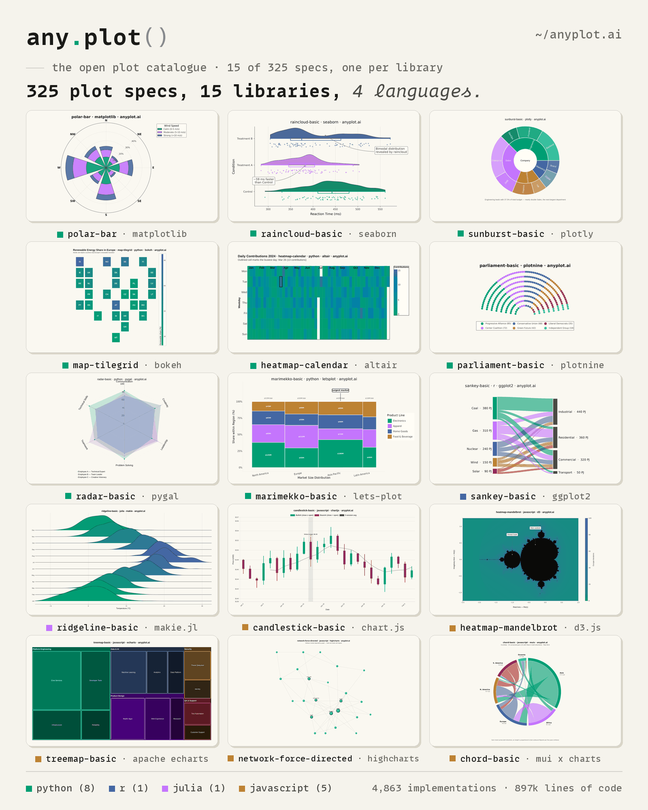
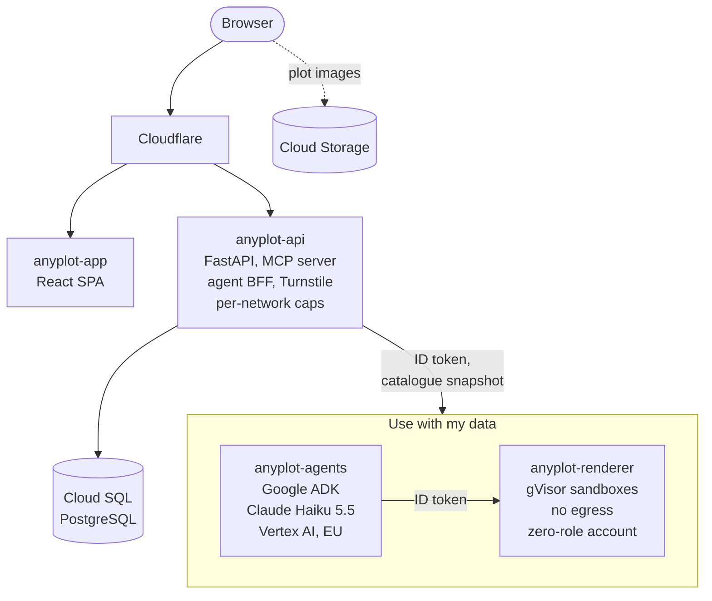
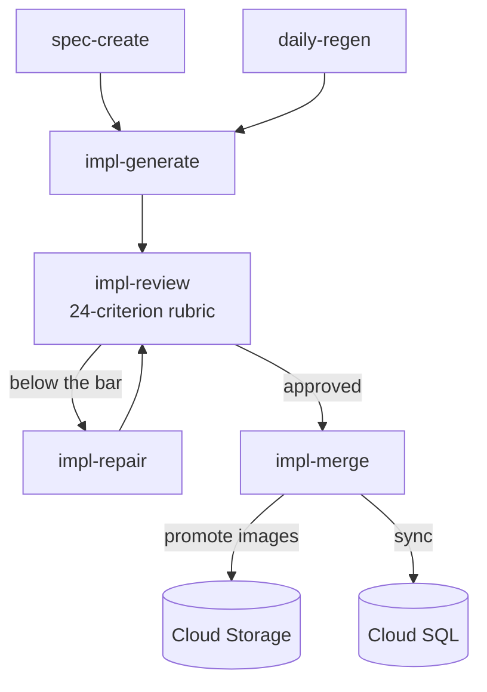

**→ [anyplot.ai](https://anyplot.ai)**

[](https://github.com/MarkusNeusinger/anyplot/releases)
[](https://www.python.org/)
[](LICENSE)
[](https://github.com/MarkusNeusinger/anyplot/actions/workflows/ci-tests.yml)
[](https://github.com/MarkusNeusinger/anyplot/actions/workflows/ci-lint.yml)
[](https://codecov.io/github/MarkusNeusinger/anyplot)

anyplot is an open catalogue of plotting examples. Each plot type starts as one library-agnostic specification, and an
AI pipeline writes, renders, reviews, and maintains its implementations in 15 plotting libraries across Python, R,
Julia, and JavaScript. On [anyplot.ai](https://anyplot.ai), you compare the libraries side by side and copy working
code.

## How I build anyplot

I'm [Markus Neusinger](https://linkedin.com/in/markus-neusinger/), a physicist working in data and AI: since 2013 I've built data pipelines, analyses and machine learning, and the apps people use them through. Models write anyplot's code; I lead them, with that experience across data, backends, frontends and hosting.

- **I set the course.** The vision, the decisions, and the structure that keeps a codebase written by agents from turning into a mess. Seven of those decisions are [below](#engineering-highlights).
- **I know when to push back.** The models know a lot. The job is knowing which question to ask, when to make a model research a point properly, and when a confident answer is wrong. Security is a good example: I know what has to hold, private data and no way to abuse the service, and asking the right question is often enough for a model to find what still needs hardening.
- **I split, assign, test, and send back.** Work goes to Claude Code, Claude in GitHub Actions, Gemini or Copilot by what it needs and what it costs. I test what comes back and return it until it's right.

This isn't one prompt and a wait. Since November 2025, more than 950 pull requests from my account have merged, and what I correct becomes a rule the agents follow. [How anyplot is built with AI agents](docs/concepts/ai-workflow.md) tells the whole story.

[](https://anyplot.ai/plots)

*One spec in each library, drawn from the live catalogue by
[`scripts/readme_showcase.py`](scripts/readme_showcase.py). [Browse all plots](https://anyplot.ai/plots).*

---

## Engineering highlights

Seven decisions I made and hold the agents to, each with its reason and the code that carries it out:

- **A review loop instead of hand-edits.** No generated plot is patched by hand. An AI reviewer scores every
  render on a 24-criterion rubric, blind to any earlier score, and a repair loop fixes the defects it names,
  against a bar that starts at 90 of 100 and drops 10 points per repair. A fix to a prompt or a spec fixes
  every plot it governs. ([rubric](prompts/quality-criteria.md), [review workflow](.github/workflows/impl-review.yml))
- **A gate against silent regressions.** Every night the oldest implementations are regenerated, and a new
  version replaces the live one only when a pairwise review of both finds a visible fix and the new score
  drops by no more than a point. A newer model can't quietly make the catalogue worse.
  ([`regen_gate.py`](automation/scripts/regen_gate.py), [`daily-regen.yml`](.github/workflows/daily-regen.yml))
- **One agent talks, code decides.** In "Use with my data", one Google ADK agent talks to the user. The
  per-library adapters and the reviewer run inside a pipeline whose loop is plain code: at most one repair
  round, at most two reviews, and the spec, library, and data come from server state, so neither the model
  nor an injected prompt can redirect a run. ([`pipeline.py`](agents/anyplot/pipeline.py),
  [design](docs/concepts/agent-network.md))
- **Model-written code runs where it can't do harm.** No generated code runs in the agent service. A
  validator (Python's `ast`, tree-sitter for R, Julia, and JavaScript) refuses disallowed imports and calls
  first; a separate renderer then runs the code in Cloud Run sandboxes (gVisor) with no network egress, no
  metadata server, and a read-only root filesystem, under a service account that holds no IAM role.
  ([renderer](agents/renderer/main.py), [validator](agents/anyplot/code/validate.py))
- **Models choose, the server acts.** The assistant never hands the server data rows: it picks from a closed
  set of typed operations, which the server applies with pandas and reports with counts, and example data
  comes from formulas or a sandboxed snippet whose written-out values the validator caps. Guardrail plugins check
  every turn: a scope judge that fails closed, token and run budgets per request, user, network, and day,
  and a tool allowlist per agent. ([operations](agents/anyplot/data/prepare.py),
  [plugins](agents/anyplot/plugins/))
- **Private by construction.** Chats and data live only in server memory and are dropped after an hour
  idle, and the session id never appears in a URL. Usage telemetry holds only enums, buckets, and counts,
  keyed by hashes under a per-process random salt, and a canary test fails if any message or data value
  reaches a log line. ([telemetry](agents/anyplot/telemetry.py),
  [canary test](tests/unit/agents/runtime/test_canary.py))
- **Rules that turn a repeated mistake into a check.** A mistake that comes back becomes a test or a written
  rule, with the incident beside it. One test keeps the assistant's prompt in step with the buttons the chat
  page renders; another asserts that no agent has a code executor or a search tool. After a green deploy
  left anyplot.ai blank for 45 minutes, every merge ends with a smoke test of the live site, and CI runs the
  same check on the built image. Around them: a changelog fragment per pull request checked in CI, every
  migration run against a throwaway PostgreSQL, CodeQL, and Dependabot.
  ([prompt-control test](tests/unit/agents/test_prompt_controls.py),
  [site smoke test](scripts/site-smoke.mjs), [guardrails](.claude/guardrails.md))

## Architecture

The site and "Use with my data":



The catalogue pipeline, in GitHub Actions, writing to the same storage:



All of it runs live at [anyplot.ai](https://anyplot.ai).

## The catalogue in numbers

| Specifications | Implementations | Libraries | Languages |
|---------------:|----------------:|----------:|----------:|
| 325 | 4,863 | 15 | 4 |

Counted on 2026-11-02 from the public API (`https://api.anyplot.ai/stats`); the [stats page](https://anyplot.ai/stats)
shows the current numbers. 316 of the 325 specs exist in all 15 libraries; the other nine, mostly 3D and map plots,
lack one or two.

| Language | Libraries |
|----------|-----------|
| Python | matplotlib, seaborn, plotly, bokeh, altair, plotnine, pygal, lets-plot |
| R | ggplot2 |
| Julia | Makie.jl |
| JavaScript | Chart.js, D3.js, ECharts, Highcharts, MUI X Charts (React) |

## What you can do on the site

- **Compare libraries.** Each spec page shows the same plot in every library, usually all 15, in a light and a dark
  theme, each with its code and its review score.
- **Search and filter.** A typo-tolerant search matches spec titles and tag values, and the matches become filters:
  language, library, plot type, data structure, domain, and features, plus implementation tags such as techniques,
  dependencies, and styling.
- **Explore by similarity.** The [map](https://anyplot.ai/map) draws the catalogue as a graph of specs linked by tag
  similarity, and every spec page lists related specs.
- **Use it from an AI assistant.** The [MCP server](#mcp-server) serves the same catalogue to coding agents.

## How the pipeline works

AI writes every implementation, most of them Claude running in GitHub Actions. GitHub issues hold the state of each
plot.

1. **Request.** Someone opens an issue, from GitHub or from a link on anyplot.ai.
2. **Specification.** `spec-create.yml` checks for duplicates, assigns a spec ID and tags, and opens a pull request with
   the spec. The maintainer approves it on the issue.
3. **Generation.** `impl-generate.yml` writes one implementation per library and renders it in both themes.
4. **Review.** `impl-review.yml` first runs automated checks: the code parses and runs, the image exists and isn't
   blank, and the canvas has its target size. An AI reviewer then scores the render, blind to any earlier score, on a
   100-point rubric of 24 criteria ([`prompts/quality-criteria.md`](prompts/quality-criteria.md)): visual quality 30,
   design 20, spec compliance 15, data quality 15, code quality 10, and library mastery 10.
5. **Repair.** Below the bar, `impl-repair.yml` fixes the defects the review named, and the plot is reviewed again.
6. **Merge.** `impl-merge.yml` merges the pull request, promotes the images from staging to production in Cloud
   Storage, and syncs PostgreSQL.

### The quality bar

- A first review needs **90 of 100**. Each repair lowers the bar by 10 points: 80, 70, 60, and 50 after the fourth and
  last repair. An implementation still below 50 is closed and marked failed.
- The rubric reserves 90 and more for a plot that "should genuinely impress a data visualization professional". The
  reviewer never sees the thresholds.
- Technical criteria start at full points and lose them only through a written defect line that names the criterion,
  the observed value, and the fix. Design and library criteria start at a default and rise only with named evidence.
- Code that fails to run, a blank image, clipped labels, or a static library faking interactivity scores 0.
- One exception to the bar: a review of 80 or more that names no defect and gives every technical criterion its full
  points is approved, because a repair would have nothing to fix.

### Nightly regeneration

`daily-regen.yml` regenerates the oldest part of the catalogue every night: by default the oldest spec in every
library, and since 2026-10-31 the two oldest single implementations instead. A regeneration replaces the live
implementation only when its review, which scores both versions, finds a fixed defect and no regression (the regen
gate).

For the labels, retries, and every workflow, see [Workflows](docs/workflows/overview.md).

## Use with my data (agent chat)

> **Status:** experimental, open to every visitor since 2 November 2026.

On a plot page, choose **use with my data** and paste your own data. An agent adapts that plot's catalogue code to your data, renders it in a
sandbox, reviews the render against the catalogue's rubric, repairs it once if needed, and returns the image and the
code.

- **Agents.** A [Google ADK](https://adk.dev) service on Cloud Run. The model is Claude Haiku 5.5 through Vertex AI in
  the EU; Gemini 3.8 Flash is a configurable second arm. Runtimes exist for all 15 libraries.
- **Sandboxed rendering.** No model-written code runs in the agent service. A separate renderer runs it in Cloud Run
  sandboxes (gVisor): no network egress, no metadata server, and a read-only root filesystem. The renderer's service
  account holds no IAM role.
- **Static validation.** Before anything runs, a validator reads the code (Python's `ast`, tree-sitter for R, Julia,
  and JavaScript) and refuses disallowed imports and calls.
- **Guard judges.** A scope judge reads every typed message before any agent sees it and fails closed; a dataset judge
  checks pasted data and notes. Spend limits apply per user and per day, and a budget guard switches Vertex AI off when
  its monthly budget is reached.
- **Evals.** A model-regression harness runs synthetic, stress, and promoted real cases; separate evals score the scope
  judge and the data preparation.
- **Content-free telemetry.** Usage events hold only enums, buckets, counts, and IDs from closed sets. No message, data
  value, or column name reaches a line, and a test enforces it.

Read the [agent network design](docs/concepts/agent-network.md), the [agents README](agents/README.md), and the
[telemetry reference](docs/reference/agent-telemetry.md).

## MCP server

anyplot runs an [MCP (Model Context Protocol)](https://modelcontextprotocol.io/) server, so AI assistants can search
the catalogue and fetch implementation code.

| Tool | What it does |
|------|--------------|
| `list_specs` | Lists all plot specifications |
| `search_specs_by_tags` | Finds specs by tags: plot type, data type, domain, features, library, and implementation tags |
| `get_spec_detail` | Returns a full specification with its implementations |
| `get_implementation` | Returns the code for one library |
| `list_libraries` | Lists the supported libraries |
| `get_tag_values` | Lists the values of a tag category |

Add it to your MCP client configuration, for example Claude Code's `.mcp.json`:

```json
{
  "mcpServers": {
    "anyplot": {
      "command": "npx",
      "args": ["-y", "mcp-remote", "https://api.anyplot.ai/mcp/"]
    }
  }
}
```

The server speaks Streamable HTTP only. Clients with native support connect to `https://api.anyplot.ai/mcp/` without
the `mcp-remote` bridge. The legacy SSE endpoint (`https://api.anyplot.ai/sse/`) has been removed. For details, see
[MCP server](docs/reference/mcp.md).

Each MCP request is counted as one content-free line: the tool's name and any catalogue id it looked up, never its
other arguments or its results. The [stats page](https://anyplot.ai/stats) shows how many arrived in the last 28
days, beside the verified crawler reads per day; see [Machine readers](docs/reference/machine-readers.md).

## Tech stack

| Area | Stack |
|------|-------|
| Backend | Python 3.14, FastAPI, SQLAlchemy (async), PostgreSQL, Alembic |
| Frontend | React 19, TypeScript, Vite, MUI |
| Agents | Google ADK, Claude Haiku 5.5 on Vertex AI, Cloud Run sandboxes |
| Pipeline | GitHub Actions with Claude Code |
| Infrastructure | Cloud Run, Cloud SQL, Cloud Storage, Cloud Build, BigQuery, Cloudflare |

Each render runtime is pinned: Python by `pyproject.toml` and `uv.lock`, the JavaScript libraries by `package.json` and
`package-lock.json`, Julia by `Project.toml` and `Manifest.toml`, and R by a dated Posit Package Manager snapshot.

## Project structure

```
anyplot/
├── plots/              # One directory per plot type: spec, metadata, implementations
├── prompts/            # Generation and review prompts, the quality rubric
├── .github/workflows/  # The pipeline (spec-create, impl-*, daily-regen) and CI
├── api/                # FastAPI backend and the MCP server
├── app/                # React frontend
├── agents/             # "Use with my data": ADK agent service, sandbox renderer, evals
├── core/               # Shared Python logic: database, palette, checks
├── automation/         # Workflow scripts: sync, labels, the regen gate, the JS render harness
├── alembic/            # Database migrations
├── tests/              # Unit, integration, and end-to-end tests
├── infra/              # Cloudflare configuration
├── scripts/            # Maintenance scripts
├── tools/, changelog.d/  # Changelog tooling and one changelog fragment per pull request
├── agentic/            # Commands and docs for the coding agents that work on this repository
└── docs/               # Documentation
```

The root `package.json` and `package-lock.json` pin the JavaScript render runtime, and `Project.toml` and
`Manifest.toml` pin the Julia one. A plot directory looks like this:

```
plots/scatter-basic/
├── specification.md     # Library-agnostic specification
├── specification.yaml   # Tags, creation date, issue
├── metadata/            # Per-library quality score, review, preview URLs
└── implementations/
    ├── python/          # matplotlib.py, seaborn.py, … (8 files)
    ├── r/ggplot2.R
    ├── julia/makie.jl
    └── javascript/      # chartjs.js, d3.js, echarts.js, highcharts.js, muix.tsx
```

For every directory, see [Repository structure](docs/reference/repository.md).

## Contributing

You contribute ideas, not code: the pipeline writes every implementation.

| Action | When to use | On anyplot.ai |
|--------|-------------|---------------|
| Suggest a spec | Propose a new plot type | `spec.suggest()` on the home page and the specs list |
| Report a spec issue | A specification has a problem | "report issue" on the spec page |
| Report an implementation issue | One library's implementation has a problem | "report issue" on the spec page |

1. Open an issue, on GitHub or through a link on anyplot.ai.
2. The AI validates and processes it.
3. The maintainer reviews and approves it.
4. The pipeline generates or fixes the code, and the review gates it.

Don't open pull requests with plot code. A plot with quality problems usually needs a better spec, not hand-edited code.
For details, see [Contributing](docs/contributing.md). To run the project locally, see the
[development guide](docs/development.md).

## Documentation

- [Vision](docs/concepts/vision.md): the product vision
- [Workflows](docs/workflows/overview.md): the automation and its labels
- [Agent network](docs/concepts/agent-network.md): the design of "Use with my data"
- [How anyplot is built with AI agents](docs/concepts/ai-workflow.md): who does what, the path of a change,
  and how corrections become rules
- [Reference](docs/reference/): API, MCP, database, repository structure, and style guide
- [Documentation index](docs/index.md): everything else

## License notes

Most plotting libraries are fully open source. **Highcharts** is free for non-commercial use; commercial use requires a
license from [highcharts.com](https://www.highcharts.com/license).

The project is under the MIT License; see [LICENSE](LICENSE). The JetBrains Mono fonts bundled in
`agents/anyplot/render/fonts/` for the footer strip of user plots are third-party files under the SIL Open Font License
1.1; see [their notice](agents/anyplot/render/fonts/README.md).

## Links

- **Website**: [anyplot.ai](https://anyplot.ai)
- **Issues**: [GitHub Issues](https://github.com/MarkusNeusinger/anyplot/issues)
- **Discussions**: [GitHub Discussions](https://github.com/MarkusNeusinger/anyplot/discussions)
- **Analytics**: [public Plausible dashboard](https://plausible.io/anyplot.ai) for people; machine readers (verified
  crawlers, AI assistants, MCP) on the [stats page](https://anyplot.ai/stats), counted from content-free request lines

---

<div align="center">

**Built by [Markus Neusinger](https://linkedin.com/in/markus-neusinger/)**

[Star on GitHub](https://github.com/MarkusNeusinger/anyplot) • [Request a new plot](https://github.com/MarkusNeusinger/anyplot/issues/new?template=request-new-plot.yml)

</div>
